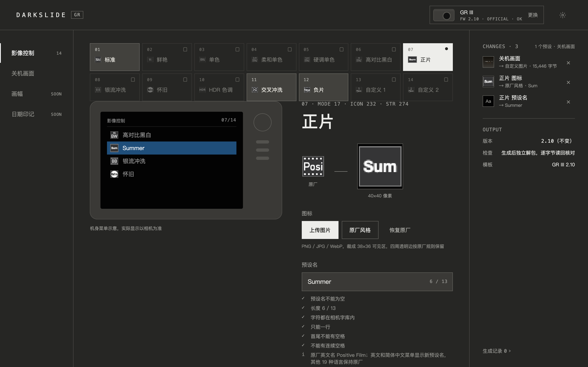
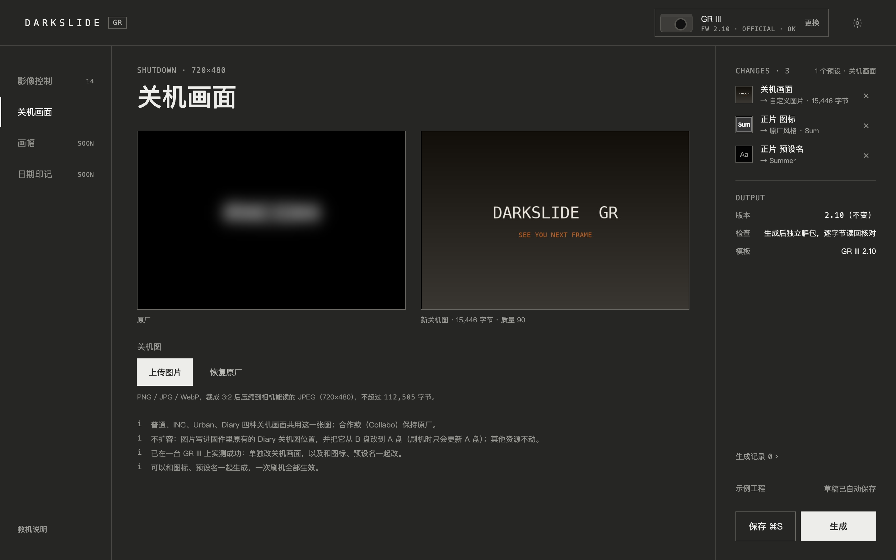
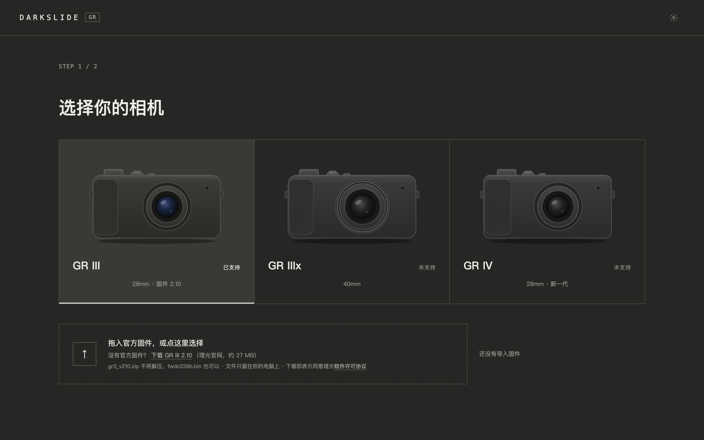
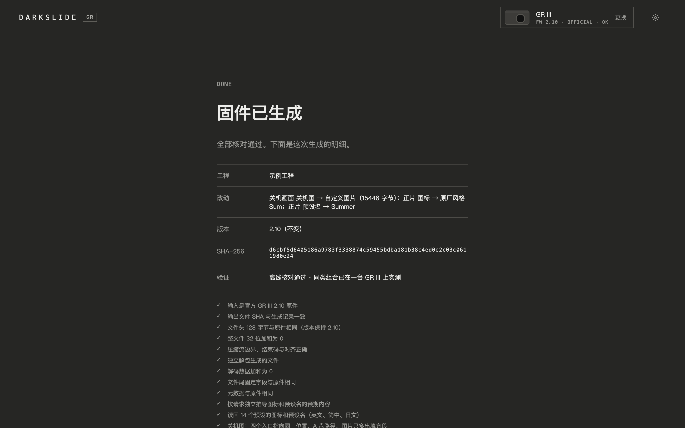

# Darkslide GR

[简体中文](README.md) | English

Give your GR III your own preset icons, preset names and shutdown screen, right from a browser on your own computer.



> [!WARNING]
> **Flashing modified firmware is risky. Please read this first.**
>
> - Your camera may fail to boot, stop working properly, or be **permanently bricked**. You may also lose warranty and official support.
> - The author has flashed and tested it on **one** GR III (firmware 2.10): icons and preset names, the shutdown screen, and all three together, with no problems found. That is a sample of one camera, and your own icons, preset names and pictures have never been on real hardware; all pre-build checks run offline and are no substitute for testing on hardware.
> - This project is not affiliated with or endorsed by RICOH. The author accepts no liability for any damage.
> - What Darkslide produces is a firmware file, nothing more: it **does not talk to your camera or touch your memory card**. Flashing it, and how, is your call.
>
> If it breaks, you get to keep both pieces. If you can't live with a very stylish brick, don't flash it.

## No RICOH firmware included

This repository does **not** contain any RICOH firmware, stock or modified, and does not offer any for download. Bring your own official file and make sure you are entitled to use it.

The tool accepts exactly one input file and checks it on import:

| Item | Value |
|---|---|
| Model / version | GR III · firmware 2.10 |
| File name | `fwdc239b.bin` |
| Size | 30,391,780 bytes |
| SHA-256 | `d6a3c9c288d784080e7b283222ecdd8752adfeed6faa36dab44f73115354bfd4` |

Check it yourself: `shasum -a 256 fwdc239b.bin` (Windows: `certutil -hashfile fwdc239b.bin SHA256`)

## What it does

Give the presets in your GR III menu **your own icons and names**. For example, rename "Positive Film" to "Summer" and give it a small icon you designed yourself; that is how it will appear in the camera menu.

**Presets you can change right now**

| Preset | Icon | Name |
|---|---|---|
| Positive Film, Cross Processing, Negative Film | ✅ | ✅ |
| Standard | ✅ | — |
| Other presets | Coming in later versions | |

- **Two ways to make an icon**: upload any image and frame it with the crop box, or type a few letters to generate a text icon in the factory style.
- **Preset names**: checked as you type, e.g. too long, or characters the camera can't display.
- **What it never touches**: colour rendering, image-quality parameters and all other settings stay as they are. The firmware version stays 2.10.
- **Projects**: drafts are saved automatically; save multiple versions, undo and redo, and pick up where you left off.

**Shutdown screen**

Upload a picture; it is cropped to 3:2 and converted to a format the camera can read, and the camera shows it when you switch off (except the collaboration style). Only the existing shutdown-image slot in the firmware is replaced; nothing is enlarged. It can be built into the same file as icons and preset names and flashed in one go (this combination has been tested on hardware too).



## How it keeps you safe

- Only the official GR III 2.10 original is accepted; anything else is rejected.
- Every build starts again from the original, then a separate, independent unpacker takes the result apart and checks it. **Download is offered only if every check passes**, together with a build manifest listing what changed.
- One more check that does not depend on what you changed: the version is still 2.10, and the boot records and the firmware-update regions identified by the author's analysis are byte-for-byte untouched. This is meant to keep the official original usable for flashing back; it is an offline check, not a guarantee, the recovery path has not been verified step by step on hardware, and a camera that cannot power on at all is not covered.
- A built-in recovery guide shows you how to prepare a recovery card before flashing and how to flash back to official firmware if something goes wrong.

The interface is currently in Chinese.

## Screens

| Choose camera, import firmware | Build and verify |
|---|---|
|  |  |

## Quick start

Requires Python 3.9 or newer. No third-party dependencies.

```sh
sh start.sh
```

Windows: double-click `start.cmd` (not yet tested on Windows).

The terminal prints the address it is using and your browser opens it (usually `http://127.0.0.1:8787`; if another program holds that port, Darkslide moves on to the next free one). Everything runs locally and nothing is uploaded. Data lives on your computer: `~/Library/Application Support/Darkslide` on macOS, `%APPDATA%\Darkslide` on Windows, `~/.local/share/Darkslide` on Linux; set `DARKSLIDE_DATA` to change it.

Run the tests: `python3 -m unittest discover -s tests`
(To include the real-firmware tests, set `DARKSLIDE_OFFICIAL_BIN` to the path of your `fwdc239b.bin`; otherwise they are skipped.)

## Reporting issues

Use the "Bug report" form under [Issues](../../issues). Include camera model, firmware version, file SHA-256 and steps to reproduce.

**Please never upload firmware files.** The SHA-256 is enough.

## License

[GPL-2.0-only](LICENSE). The author asks that it be used only for personal learning, sharing and research, and not for commercial purposes such as selling it or charging for flashing (this request is not an additional license condition).

See the [author statement](AUTHOR_STATEMENT.md) and [third-party notices](THIRD_PARTY_NOTICES.md) (in Chinese), and the [changelog](CHANGELOG.md).
